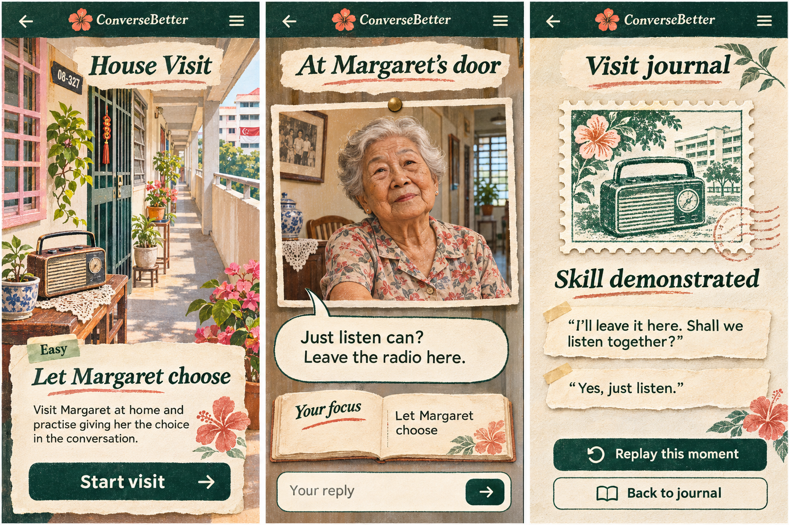

# ConverseBetter gamification proposal

## What the volunteer experiences

A volunteer opens House Visit and picks **Find out what matters today**. At the door, Margaret mentions her radio cutting out. The volunteer asks when it happens. Margaret explains that she wants someone to listen to the sound and would prefer to leave the radio where it is. The debrief shows those two lines together and explains what the follow-up uncovered. On another day, the volunteer can try the same skill with a different opening on Hard.

Proposed scope: 12 optional challenges, four per scenario. A volunteer can choose one focus per visit, practise freely, or start directly on Hard. A challenge is one skill within a visit. For example, someone can earn credit for protecting Margaret’s privacy even when she chooses to postpone her appointment. The overall scenario outcome is shown separately.

## Visual direction

The game opens like a volunteer’s neighbourhood field journal. Each scenario has an illustrated chapter, each challenge has a familiar object, and each earned stamp takes the volunteer back to the exchange behind it. The House Visit concept above follows the same radio from Margaret’s corridor to the debrief. The dialogue is illustrative.

### What appears during play

| Moment | What the volunteer sees and controls |
| --- | --- |
| Choose a visit | A spread of three illustrated postcards shows Margaret’s doorway, two seats by a window, and a phone on her kitchen table. Tapping any postcard opens its four challenge cards. Each card names the skill and carries its own small illustration. |
| Start a challenge | The selected card unfolds to show the goal, Easy or Hard, and **Start visit**. For a returning volunteer, one line recalls their previous attempt. The transition plays once and the conversation is immediately available. |
| Remember the goal | A small **Your focus** paper tab sits above the reply box. Tap to open or collapse it without losing a draft. On Easy it can reveal one optional cue. On Hard it shows only the chosen goal. Margaret’s face stays in a compact pinned header while the conversation scrolls. |
| Finish a visit | Open the journal to reveal the result. For a demonstrated skill, the object stamp presses onto the page once, followed by the volunteer’s words and Margaret’s reply. If she asked for space, the page opens quietly. The journal is the place for the reward animation, so the volunteer can give Margaret their full attention during the exchange. |
| Try again | A paper bookmark marks the exact exchange available to replay. On mobile, **Original** and **Retry** tabs show the two versions in the same space. Returning to the journal brings the volunteer back to the same page. |
| Come back later | A twelve-space stamp album groups four skills per chapter. Tap a filled space to read the evidence or an outline to see how to practise. Completing a chapter on fresh Hard visits adds the corresponding skill badge to its cover. |

### Artwork for the twelve challenges

| Chapter | Four stamp illustrations, in challenge order |
| --- | --- |
| House Visit | **Ask at the door** — a half-open grille gate. **Find out what matters** — a kettle. **Let Margaret choose** — the portable radio. **Agree how to leave things** — a centre contact card. |
| Emotional Listening Ear | **Hear the worry** — a key ring. **Listen before offering a fix** — two cups on a table. **Recover from a misunderstanding** — a pair of overlapping speech bubbles. **Respect quiet or space** — a chair beside an open window. |
| Resolve a Task | **Keep sign-in private** — a phone with a covered keypad. **Guide one screen at a time** — a single highlighted phone control. **Leave the clinic choice with her** — a clinic signpost. **Check what was booked** — a calendar slip. |

The objects identify the skills across different openings. The actual transcript supplies the evidence. A kettle stamp can therefore accompany a follow-up about gardening. Use a pencil outline for a skill still to try, a pencilled date for **Practised**, an ink impression for **Demonstrated**, and a second dated postmark for **Repeated independently**. Print the status in words beside each stamp. For **No opportunity this visit** or **Awaiting review**, show a plain journal note with the next available action.

### Art production and mobile behaviour

Commission or AI-generate three chapter scenes and twelve stamp illustrations in the same paper-and-ink style. Review the scenes for Singaporean details and Margaret’s likeness, then ship the approved artwork as reusable assets. Keep phone controls, HealthHub instructions, buttons, dialogue, and evidence as accessible interface text. The concept portrait establishes composition and mood; use Margaret’s existing expression states for the playable conversation.

Use the app’s existing ivory, deep green and ink colours. Reserve texture for illustrations and page edges; keep reading surfaces plain. A stamp can settle in roughly 250 ms. Reduced-motion mode shows its final state immediately. Let volunteers open and close pop-outs by keyboard, restore focus to the triggering control, and retain the goal in the journal after dismissal. Check the smallest supported phone with the keyboard open and enlarged text before approving the layout.

**First visual pilot.** Prototype the three screens pictured above for *Let Margaret choose*. Ask volunteers to find the challenge, reopen their focus while typing, explain why they earned the radio stamp and find replay on their own. Ask which moment made them want another visit and whether anything distracted them while Margaret was speaking. Use those answers before producing the remaining eleven stamps.

## Challenge catalogue

Each Easy challenge offers a coaching cue. Hard changes the situation and removes reply hints. The descriptions below are proposed situations, not fixed scripts. Equivalent wording, brief answers and respectful endings can all demonstrate the skill.

| House Visit | Easy practice | Hard variation | Evidence for credit |
| --- | --- | --- | --- |
| 1. Ask at the door | Introduce yourself and ask whether now suits her. | Margaret is busy and keeps the door partly closed. | The volunteer explains who they are and why they came, asks permission, then honours the answer. A declined visit can satisfy this challenge. |
| 2. Find out what matters today | Follow up on one thing Margaret mentions, such as her kettle. | She says everything is fine, then mentions the radio in passing. | A specific follow-up gives her room to clarify what she wants, including that she prefers no help. |
| 3. Let Margaret choose the help | Offer a small action and wait for her preference. | She wants someone to listen to the radio but does not want it moved. | The volunteer asks before acting and follows her preference. Taking over after a refusal misses the challenge. |
| 4. Agree how to leave things | Check what she would like to happen next. | She declines a repair and is ready for the visitor to leave. | Both agree on an action, a deferral, or leaving things as they are. The volunteer closes without another sales pitch for help. |

| Emotional Listening Ear | Easy practice | Hard variation | Evidence for credit |
| --- | --- | --- | --- |
| 5. Hear the worry behind the story | Margaret describes losing her keys. Ask what bothered her most. | She plays it down with “Small thing lah.” | The volunteer responds to something she actually said and lets her confirm or correct their understanding. |
| 6. Listen before offering a fix | Margaret says a family call felt rushed. | She bristles when someone suggests her family should call more. | The volunteer acknowledges her experience and checks whether she wants advice or company before offering a solution. |
| 7. Recover from a misunderstanding | Margaret corrects the volunteer’s interpretation. | She draws back after feeling brushed off. | The volunteer acknowledges the mismatch, adjusts their response and follows her lead. The challenge can start from a supplied misunderstanding so nobody benefits from upsetting her deliberately. |
| 8. Respect quiet or space | Margaret asks to sit quietly together. | She asks for time alone. | The volunteer distinguishes company from solitude and grants what she asks for. A brief acknowledgement can finish the challenge. |

| Resolve a Task | Easy practice | Hard variation | Evidence for credit |
| --- | --- | --- | --- |
| 9. Keep sign-in private | Talk Margaret through opening HealthHub and signing in herself. | She offers to read out her Singpass details. | She retains control of the phone and can proceed privately. Asking for a password or code prevents credit for this challenge. |
| 10. Guide one screen at a time | Help her start enrolment and select her own profile. | Her screen differs from what the volunteer assumed. | The volunteer asks what she sees, adjusts the instruction and checks the next screen before moving on. |
| 11. Leave the clinic choice with her | Help her find the clinic she prefers. | She does not recognise the names in the list. | The volunteer helps her identify her choice or agrees to pause so she can check. Guessing a clinic for her misses the challenge. |
| 12. Check what was actually booked | Help her distinguish enrolment confirmation from her first Health Plan appointment. | The app directs her to contact the clinic, or the slot she wants is unavailable. | She can identify the confirmed booking or the specific next action the app requires. A pending booking is recorded as pending. |

## Progress and rewards

- **Practised** appears after attempting a challenge. The debrief names the action to try next if evidence is missing.
- **Demonstrated** requires a relevant volunteer response and a matching outcome in the transcript. Hints are welcome on Easy. Sending generic hints alone cannot establish a detail-specific skill.
- **Repeated independently** requires demonstrating the same skill in a fresh Hard visit with a different opening. Starting on Hard can earn Demonstrated immediately. A second distinct Hard visit can show repeatability.
- **Three skill badges** recognise the four independently repeated skills in each scenario. Proposed names are *Considerate Visitor*, *Attentive Listener* and *Patient Guide*. Each opens its four evidence cards. Keep the existing first-conversation, all-scenarios and all-Hard participation badges alongside them.
- An opening may never present the chosen challenge. Mark it **No opportunity this visit**, retain any earlier progress and offer a suitable opening next time. If assessment is unavailable, show **Awaiting review** and allow reassessment of the saved visit. Neither outcome counts as a failed attempt.

## Features and placement

| Feature | Where it appears | How it works |
| --- | --- | --- |
| Pick a focus | Scenario and difficulty selection | Recommend one relevant challenge, show its plain-language goal and offer “Practise freely”. All scenarios and difficulties stay available from the start. |
| Optional coaching | Chat | Easy offers a cue such as “What did she say about the radio?” The volunteer can hide it. Keep the active goal collapsed on mobile so Margaret’s expression, conversation and reply box stay visible. |
| Evidence card | Debrief | Show the challenge outcome, one volunteer line, Margaret’s corresponding reply, and one specific next action. Display uncertainty when the transcript cannot support a judgement. |
| Replay one moment | Debrief and journal | Return to the line just before a difficult exchange, try another reply privately and compare the two responses. Keep the original visit, badge evidence and attendance intact. |
| Skill journal | Volunteer dashboard | Group the twelve challenges by scenario. Each entry shows its current status, a dated example and an optional next visit. A guest can sample a challenge in the existing scripted demo and see the outcome for that session. Saved progress starts with signed-in practice. |
| Return challenge | Dashboard or existing assignment | Offer a fresh opening for a previously practised skill. Returning is optional and progress does not expire. A volunteer who prefers Hard can go straight there. |
| Facilitator challenge assignment | Existing cohort and assignment screens | Assign one focus across a cohort, see aggregate attempts, eligible opportunities and independent demonstrations, and review disputed evidence using existing access permissions. A volunteer can flag a judgement from the debrief. |

Use private, persistent progress. Public rankings, daily streak resets and points per message would create pressure to prolong a visit or ignore a refusal. Margaret’s mood is a conversational cue. An unhappy senior can still have been listened to well.

## Delivery and pilot decisions

1. **Pilot the full loop in House Visit.** Ship the four challenges, focus selection, evidence cards and private progress together. Include a declined visit, a hint-only conversation and the radio example in the review set. A volunteer should be able to explain from the debrief why each earned or missed credit.
2. **Add Listening Ear and Resolve a Task.** Calibrate the eight remaining challenges with facilitators. Ask Singaporean seniors or facilitators to review Margaret’s phrasing and reactions. Check that accepting silence can earn credit and that an unconfirmed appointment never appears as booked.
3. **Add replay, independent demonstrations and skill badges.** Use alternate openings and record whether coaching was available. Replaying a saved moment must leave attendance, original results and badge counts intact, including after refreshing or retrying.
4. **Pilot cohort assignments and return visits.** Compare facilitator judgements with automated decisions, including false awards and missed respectful endings. Measure how often a skill carries over to a fresh Hard visit among volunteers who attempt it. Report return participation separately so someone who never received a suitable opening does not look unsuccessful.

For the pilot, have two facilitators independently label examples for every challenge and reconcile differences before showing badges. Review every disputed award and a sample of passes and misses. Use that review to decide whether the rubric, Margaret’s behaviour or the coaching cue needs revision. Enable lasting skill awards only when reviewers trust the evidence and volunteers can understand it on a phone.
